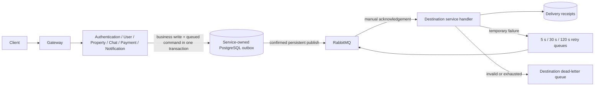

# Service messaging

One RabbitMQ broker serves all six backend services. Each service keeps its HTTP
server and runs its publisher/consumer in the same process. Scale a service's
replicas to add competing consumers; a separate worker application is unnecessary.
The gateway continues to route client HTTP and WebSocket traffic.



## What moves through the broker

| Publisher      | Destination    | Commands                                                         |
| -------------- | -------------- | ---------------------------------------------------------------- |
| Chat           | Notification   | Stored chat message push                                         |
| Authentication | Notification   | New-device sign-in push                                          |
| Authentication | Authentication | New-device sign-in email                                         |
| Payment        | Authentication | Order confirmation email                                         |
| Payment        | Notification   | Listing and subscription expiry reminder                         |
| Property       | Property       | Listing went live, price dropped, sold; listeners prepare alerts |
| Property       | Notification   | Saved-search match, followed listing, saved listing update       |
| User           | Chat           | Blocked users' existing presence subscriptions must separate     |
| User           | Property       | Owner visibility/profile changed; refresh listing caches/search  |

The versioned allowlist and source/destination ownership live in
`shared/src/messaging/message-contracts.ts`. Receivers validate payloads with the
same DTOs and methods used by their internal HTTP controllers. Unknown versions,
wrong destinations, invalid payloads, extra DTO fields and null characters go to
the dead-letter queue without executing the handler.

Immediate answers still use authenticated internal HTTP: account file erasure,
payment/publication decisions, subscription allowances, block checks, follower/feed
reads and admin queries. Live call ringing/end signals also remain direct; a
delayed ringing push must never become a new incoming call after the call ended.
Chat's WebSocket and Redis presence paths continue to carry live traffic.

## Delivery and failure behavior

- Every service has a durable quorum queue `tilomnov.<service>.v1`, three retry
  queues `.retry.0`, `.retry.1`, `.retry.2`, and a `.dead` queue. Commands route
  through the durable direct exchange `tilomnov.commands.v1` by destination.
- Persistent messages, publisher confirms and mandatory routing are required.
  A broker confirmation alone does not prove a consumer processed the message.
  Unroutable publishes remain in the database outbox.
- Outbox workers poll once per second and dispatch up to 25 messages per pass.
  `FOR UPDATE SKIP LOCKED` supports multiple publisher replicas. A row is marked
  published only after confirmation. Broker failures back off up to 60 seconds;
  there is no HTTP fallback during an outage once queued mode is enabled.
- The consumer acknowledges after its handler and receipt commit. Temporary
  handler failures retry after 5, 30 and 120 seconds, then move to `.dead`.
  Forwarding to retry/dead queues also requires confirmation before acknowledging
  the original. Quorum retry queues use at-least-once dead lettering.
- Retries can reorder events; handlers use current state and idempotent claims.
  Prefetch is one per replica. Transaction advisory locks prevent concurrent
  processing of an identical event across replicas. A completed receipt prevents
  re-execution after redelivery. A duplicate currently in progress waits on the
  first retry queue without using another application retry attempt.
- Successful device deliveries have individual receipt steps, so a partial push
  failure retries the remaining devices. Deleted/unregistered devices are not
  treated as a transient provider outage.
- Default command lifetime is seven days. Expiry reminders additionally expire at
  the end of the purchased period. Expired jobs retire without side effects. Before sending a queued expiry reminder,
  Notification asks Payment whether the period is still current, preventing stale
  renewal prompts after the owner already renewed.
  Published outbox records are removed after seven days; receipts after 30 days.
- SIGTERM drains active handlers before closing the database. Compose allows
  130 seconds; configure a comparable termination grace period when deploying.
- Consumers require `DATABASE_POOL_MAX >= 2` (the current default). One connection
  holds the delivery receipt lock while the handler uses another. A smaller pool
  fails startup instead of accepting work that would deadlock.

The outbox is stored inside the service's existing database schema. Authentication
and User share `account`, and all queries also scope records by service. Migration
48 grants table access only to the owning service roles, including rotating logins
through their inherited grants. Public API database roles have no access.

Atomic outbox writes cover chat creation, verified payment confirmation emails,
listing publication/map placement/price/sold changes, block writes, reminder
markers, and listing alert claims. A failed outbox insert rolls back those writes.
Security alerts are recorded after session issuance and never turn a successful
sign-in into a failure. Profile cache invalidation is recorded after the profile
write; existing cache expiry remains its recovery path if persistence fails.

This is at-least-once processing. A crash between an external provider accepting
a push/email and saving its receipt can still repeat that delivery. There is no
claim of exactly-once delivery to Firebase or an email provider. Queued database
work must remain idempotent, and later payment consumers must use the payment's
business ID as their idempotency key before moving financial side effects async.

## Local configuration and later rollout

Apply `48_service_messaging` before setting `RABBITMQ_URL` on a backend service.
Enabled services check that their outbox/receipt tables exist at startup. An empty
URL keeps the existing HTTP behavior, allowing the migration and code to be
deployed before the broker is enabled. Enable receivers before publishers.
Existing internal HTTP routes remain available during that transition.

Compose runs `rabbitmq:4.2-management-alpine` with a named persistent volume and
stable hostname. Set `RABBITMQ_USER` (default `tilomnov`) and a URL-safe random hex
`RABBITMQ_PASSWORD`; Compose constructs the private broker URL. Management is
bound to `127.0.0.1:15672`; AMQP is not published to the host. Host-run services
need their own reachable `RABBITMQ_URL`. The gateway does not connect to RabbitMQ.

The broker is an authenticated backend trust boundary, like the current shared
internal HTTP secret. The command source allowlist is application validation, not
proof of producer identity against a compromised backend credential. Use a private
vhost/network, TLS when crossing hosts, restrict broker credentials to backend
services, and reserve the management UI for operators. Bodies/credentials are not
written to messaging logs; dead queues and outboxes can contain sensitive payloads.

A single broker with persistent storage survives process restarts, but does not
provide host-level high availability. The same quorum queue topology can run on
a properly configured three-node RabbitMQ cluster later. Redis remains a cache and
live pub/sub service; its current nonpersistent instance is not a durable queue.

Nothing in this change provisions Railway/Infisical, changes live credentials, or
applies migrations to staging/production.

## Operations

Watch ready/unacknowledged/retry/dead counts and oldest pending outbox age. A dead
message needs investigation; unlimited immediate requeueing hides broken payloads
or provider configuration. A transient provider outage should first be fixed,
then replay identical, unexpired dead work with the original message ID and
`x-retry-attempt: 0` through the destination queue. Retaining the ID preserves
receipts and successful device steps. Corrected/new work needs an explicit decision
about its business idempotency; replaying an expired envelope is intentionally ignored.

For each service's schema, pending publications can be inspected without payloads:

```sql
SELECT service, count(*), min(created_at) AS oldest
FROM chat.service_outbox
WHERE published_at IS NULL
GROUP BY service;
```

## Repeatable verification

```powershell
docker compose -f qa/messaging/docker-compose.yml up -d --wait
npm run build
npm test
npm run test:messaging:integration
npm run test:messaging:flows
docker compose -f qa/messaging/docker-compose.yml down --volumes
```

Integration tests use only fixed, disposable localhost PostgreSQL/RabbitMQ
containers. They never read `.env`. They test migration permissions and reruns,
transaction rollback, producer deduplication, delivery through real notification
and email handlers, multiple consumer replicas, all configured retry delays,
poison messages, unroutable confirms, channel recovery, broker restart/persistence,
outage acceptance and recovery. External Firebase/email delivery is replaced by
test senders. Existing workspace tests cover the synchronous API flows and HTTP
compatibility mode. CI runs these broker tests before a deployment can proceed.

The persisted flow command prepares a second disposable localhost database with
all migrations, then runs publishing, subscription, income-retention, takeover,
and feed checks. Payment/publishing runs in both HTTP and queued modes, including
a forced outbox failure and subsequent successful payment reconciliation.

RabbitMQ's delivery semantics:
[Acknowledgements and confirms](https://www.rabbitmq.com/docs/confirms),
[dead lettering](https://www.rabbitmq.com/docs/dlx).
