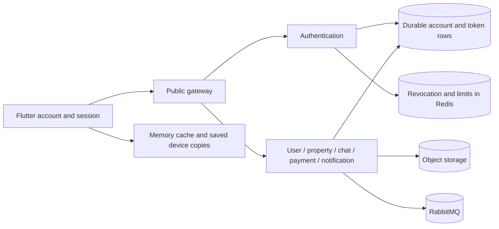

# Tilomnov security audit and fix plan — 2026-11-12

**What this repo does:** Tilomnov is a public property marketplace with a Flutter client, seven NestJS services, PostgreSQL, Redis, storage, RabbitMQ, payments and protected admin operations. This audit assumes unrelated public users, malicious registered accounts, shared phones, concurrent requests and multiple service instances.

**Verdict:** Fix the refresh/revocation race and Flutter account-switching leaks first. The review found nine actionable application or release findings: four rated High, including two configuration-dependent risks, and five Medium. Three additional hardening/history observations and deployment checks are listed separately. No production compromise is asserted.

This is an audit and implementation plan. Application code, deployments, databases, credentials and provider settings were not changed.

## Scope and evidence

| Repository | Reviewed HEAD | Working tree |
| --- | --- | --- |
| `genie-backend` | `c52812abaca3c7023da3aefad8c7485f141b71d0` | Included existing uncommitted changes |
| `genie` | `bb7c8d516de9ce065503ac28c7320c700555254f` | Included existing uncommitted changes |

The inventory covered 808 backend tracked files and 1,080 frontend tracked files. Of these, 736 and 842 respectively were source/configuration files after excluding generated/build directories. These are inventory and scan counts, **not a claim that every file was manually read**. Manual tracing concentrated on security boundaries and connected callers; unrelated presentation and artwork received broad searches and the test run rather than a line-by-line review. Snapshot hashes are in [validation-summary.json](security-audit-2026-11-12/validation-summary.json).

The installed `redteam-boundary-policy` skill and its durable runtime were used. Operation: `run-f3cf80eef36248655d2fa92e895b04f1`. Local evidence distinguishes source facts, fixture reproductions and unverified deployment conditions. The local workflow completed with its evidence/cleanup contract satisfied; [runtime-evidence.json](security-audit-2026-11-12/runtime-evidence.json) records artifact IDs and hashes. A runtime verification result describes the submitted local artifacts; it does not certify production security.

| Area | Review performed | Boundary of verification |
| --- | --- | --- |
| Gateway | Route groups, header rewriting, bearer checks, versioning, proxying, CORS, limits, trusted proxies, app links | Current source and unit tests; no public endpoint probes |
| Authentication | Registration, Google linking, admin email step, OTPs, password reset/change, token rotation, device establishment, logout/ban/delete | Source, existing suites and targeted race probes; Firebase/email delivery mocked |
| User/admin | Profile DTOs, field selection, follows, blocks, reports, admin guards, moderation, rotation/deployment/log access | Source and unit tests; provider credentials unused |
| Listings/search/feed | Ownership, publication allowance, price quotes, contact stripping, search selection, upload/confirmation, nearby provider URLs | Source and unit tests; no storage or Google calls |
| Payments | Provider selection, settlement checks, webhooks, transaction ownership, idempotency, entitlements, income queries | Source and unit tests; no bank, database or live callback |
| Chat/calls | Message ownership/replies/edits/deletion, WebSocket identity/expiry, block checks, attachments, TURN, call participation | Source and unit tests; no live sockets, TURN allocations or device calls |
| Notifications/messaging | Device ownership, preference/recipient selection, internal guards, envelope validation, queue permissions/topology, outbox/receipts | Source and unit tests; no broker/provider integration |
| Data/operations | Prisma SQL sinks, schema grants/RLS migrations, database clients, backup/restore guards, secret rotation, Docker, CI | Static review; deployed privileges/TLS/network policy unverified |
| Flutter | Auth storage, renewal/sign-out, routing, API caches, persistent copies, managed-message codec, file crypto, notifications, payment parsing | Full test run and focused probes; no real Android/iOS hardware |
| Native/web/release | Android components, lock-screen call bridge, backups and network config; iOS entitlements/ATS; web scripts; signing/build CI | Source review; installed binaries, native dependency graph and cloud key restrictions unverified |
| Dependencies/secrets | Anonymous public advisory queries, redacted tracked-text scan, targeted sensitive-file Git history | No current local `.env` values or credentials used; not a forensic scan of every historical blob |



## Validation results

- **Backend:** 145 existing unit suites, **1,491 tests passed**, zero failed. Ran each workspace directly with Jest, `--runInBand`, excluding `\.integration\.spec\.ts$`. The runner removed service credentials from the child environment. Four database/search integration files were excluded; broker/service-flow integration scripts were not run.
- **Frontend:** `flutter test --no-pub --reporter json`: **1,454 passed, 36 failed** nonhidden test results. Failures include icon finders and widget/layout expectations in the existing working tree. Sampled failures expected Material `Icon` widgets that were no longer present. This audit did not repair or fully diagnose all 36. Names and file paths are retained in the validation summary. The frontend suite is **not green**.
- **New diagnostic probes:** **10 backend probes and four Flutter probes passed**, including matched negative controls. Passing means the reported vulnerable behavior was reproduced, not repaired.
- **Production npm dependencies:** 564 package names / 592 name-version pairs checked anonymously against npm's bulk advisory endpoint. One Low advisory matched: `fast-xml-parser@5.11.2`, transitively through `@google-cloud/storage`.
- **Dart dependencies:** 262 hosted packages from `pubspec.lock` checked against OSV; no returned advisory matches. Native Gradle/CocoaPods packages and JavaScript loaded from CDNs are not covered by this check.

Evidence: [validation summary](security-audit-2026-11-12/validation-summary.json), [backend probe source](security-audit-2026-11-12/backend-probes.spec.ts), [backend probe results](security-audit-2026-11-12/backend-probes-results.json), [Flutter probe source](../../genie/docs/security_audit_2026_11_12_test.dart).

## Must fix

| ID | Severity | Problem | Evidence status |
| --- | --- | --- | --- |
| F09 | High | Refresh can restore a session after sign-out-everywhere completes | Deterministic local interleaving reproduced |
| F03 | High | A previous account's delayed response can enter the next account's caches | Two actual Flutter cache/repository paths reproduced |
| F02 | High | Loss of Redis revocation keys can restore signed-out admin access | Guard behavior reproduced; eviction/restart configuration confirmed in Compose; hosted settings unverified |
| F07 | High release risk | Production can default to automatic simulated payment settlement | Production-mode provider behavior reproduced; live environment mode unverified; simulation is an acknowledged development shortcut |

### F09 — Refresh and revocation are not one atomic operation

**Problem and impact.** A stolen refresh token can remain useful after the owner has ended all sessions. This is more serious than waiting for an old 15-minute access token to expire: a newly inserted refresh token can continue the session. The same gap affects the guarantee made during password changes/reset and concurrent refresh-theft handling.

**Evidence.** `authentication/src/auth/sessions/session.service.ts:86` revokes the presented token, then looks up the user at line 94 and issues a replacement at line 104. `refresh-token.repository.ts:139` revokes only rows with `revoked: false`. `session-revocation.service.ts:31` marks only the session IDs returned by that update. There is no common transaction or lock spanning consume-and-replace and session termination.

**Reproduced sequence.** The probe uses the real services and repository filters over an in-memory table. Refresh first marks the old row revoked and pauses before issuance. `endAllSessions` runs to completion, sees no active row for that session and records no revocation marker. Refresh resumes and inserts an active replacement. Negative control: refresh begun after revocation is refused. Database transaction scheduling and production timing were not tested.

**Smallest complete fix.** Serialize refresh consume-and-insert with revocation using the same transaction and per-user/session lock. Recheck account/session state inside that boundary; pass the transaction to the existing repository and issuer rather than calling separate writes. Password changes/reset, logout-all, individual termination, banning and replay response must use the same serialization rule. A standalone extra Redis check leaves a check-then-write race.

**Acceptance tests.** Add latch-based refresh-vs-logout-all, refresh-vs-device-revoke and refresh-vs-password-reset cases to `session.service.spec.ts`, plus a real isolated PostgreSQL concurrency test. After termination completes, no token issued from the earlier credential may be active. Preserve refresh rotation, old-key compatibility and unaffected sessions when one device is removed.

### F03 — Flutter caches can cross account boundaries

**Problem and impact.** On a shared phone, Alice starts a request, signs out and Bob signs in before it finishes. Alice's private profile can then be returned to Bob. The profile may include contact details and role information; a misbound profile also influences chat/user interface state. This does **not** grant Bob a valid Alice bearer token or bypass backend admin checks.

**Evidence and reproduction.**

1. `genie/lib/core/network/api_cache_manager.dart:29` keys responses by path/query only. `AuthService.logout` clears that cache at `auth_repository.dart:226`, but `CacheInterceptor.onResponse` at line 135 can put an earlier response back afterward. The probe starts Alice's `/users/me`, clears the cache, delivers Alice's late response, then sends Bob's request while offline. Bob receives Alice's data from the cache.
2. `genie/lib/core/storage/kept_copy_store.dart:46` asks who is signed in **at write time**. `UserRepository.getProfile` writes after the response at line 66; `ChatRepository.fetchConversationPage` does the same at line 62. The second probe switches the account while the response is pending and observes Alice's profile stored under Bob's persistent key. Normal stable-account isolation passes the negative control.

**Smallest complete fix.** Capture an account/session generation before each request. Include it in private cache identity and reject late responses for an ended generation. Bind persistent writes to the request's original account and discard them if the session changed. `CacheInterceptor` currently runs before `AuthInterceptor`, so relying only on a bearer header added by the later interceptor is insufficient. Clearing once on logout is also insufficient.

**Reach.** Update `ApiCacheManager`, `CacheInterceptor`, `KeptCopyStore`, sign-out/session-ended handling, and all account-scoped callers: profile, owned listings, favourites, feed and chat. Keep the deliberately device-scoped closest-listings copy limited to public data. Cancel old requests where practical, while retaining generation checks for responses that already completed.

**Acceptance tests.** Convert both diagnostic scenarios into no-leak regressions. Cover explicit logout, server-ended session, rapid re-login and an offline next account. Assert Alice's response is neither rendered nor written under Bob's key, and that Bob's real profile/permissions remain authoritative.

### F02 — Redis cache eviction can undo revocation

**Problem and impact.** The only access-token revocation marker is a Redis key. Compose configures Redis as a disposable 128 MB cache with `allkeys-lru`, no snapshotting and no AOF. Restart or eviction can remove an unexpired marker. A still-valid signed-out admin access token can then regain admin API access while the account itself remains an active admin.

**Evidence.** `docker-compose.yml:64`; `api-gateway/src/revoked-sessions.ts:16`; `shared/src/auth/revoked-sessions.service.ts:28`; `authentication/src/auth/sessions/revoked-session.store.ts:52`. `shared/src/auth/admin.guard.ts:54` checks marker existence and current account role, not durable session validity. The added probe shows the same fabricated, previously verified admin claims rejected when `exists` is 1 and accepted when it becomes 0. A Redis exception still correctly makes `AdminGuard` fail closed; the dangerous case is a healthy Redis that has lost the key.

**Smallest complete fix.** After fixing F09, use durable session validity as the authority, beginning with admin and account-sensitive operations. The existing active refresh-token rows can support this if rotation is atomic; a dedicated session row is an alternative only if needed. Redis can accelerate checks but a lost cache entry must not mean an ended session is active. Separate durable security state from evictable content caches; apply no-eviction/persistence settings appropriate to the selected design. Preserve the documented ordinary-user availability policy only as an explicit, bounded decision.

**Acceptance tests.** In an isolated Redis/DB environment: revoke a session, remove its marker or restart Redis, replay its still-unexpired access token and assert denial. Test admin HTTP, authentication account routes, public authenticated reads and WebSockets. Keep the current Redis-error admin denial test. Hosted Redis policy and persistence need inspection before stating whether this exact Compose risk exists in production.

[Redis's eviction documentation](https://redis.io/docs/latest/operate/rc/databases/configuration/data-eviction-policies/) confirms that `allkeys-lru` can remove keys based on recent use, without knowing that a key represents a security decision.

### F07 — Simulated payments are accepted under a production default

**Problem and impact.** `PAYMENT_MODE` unset means mock settlement, even with `NODE_ENV=production`. A normal checkout can receive `PAID` without bank payment and grant the same entitlement as a real purchase. This is an existing documented simulation shortcut, not a client-forged bank callback. It becomes a High release risk if that configuration reaches a public environment promising paid access.

**Evidence.** `payment/src/payments/mock-payment-mode.ts:5` defaults to `mock`; `payments.module.ts` chooses the mock provider unless the mode is exactly `live`; `mock-payment.provider.ts:24` returns `PAID` from the requested amount/id. Compose also defaults payment mode to mock. The diagnostic test reproduces this with `NODE_ENV=production` and no payment-mode variable; `disabled` refuses the call. The live `AbaPaywayProvider` currently throws `NotImplementedException`, which correctly avoids claiming an unverified real settlement.

**Connected effects.** The gateway returns `isSimulation`, but Flutter's `PaymentCheckout` does not retain it and the checkout service treats `Success` as paid. `payment/src/payments/admin-income.service.ts:24` includes all successful transactions without excluding `provider = 'MOCK'`, so simulations can appear as income. Live deployment values and real financial records were not inspected.

**Smallest complete fix.** Fail closed on missing/unknown production payment mode. Permit mock settlement only with an explicit nonproduction setting; retain an explicit disabled mode while the live integration is unfinished. Preserve simulation identity through Flutter receipts and admin totals. Keep existing mock ledger rows identifiable rather than deleting or rewriting financial history. Do not merely set `live` and advertise the unfinished adapter as working.

**Acceptance tests.** Production + unset/unknown/mock must not grant paid benefits. Explicit staging mock must remain testable and visibly simulated. Exclude simulations from real income. Before real charging, test provider settlement identity, amount/currency mismatch, duplicate callbacks and late settlement/refund behavior against the provider's supported verification mechanism.

## Should fix

| ID | Severity | Problem | Exploit prerequisite |
| --- | --- | --- | --- |
| F01 | Medium | Public authenticated reads ignore session revocation | Possession of an unexpired access token that was ended |
| F05 | Medium | First-password endpoint can replace an existing password without normal change protections | Backend access plus a fresh matching Firebase identity proof |
| F06 | Medium | Recovery email/account phone become public publisher contacts without a separate publication choice | Any signed-in viewer; target has an active listing |
| F04 | Medium | Saved chat previews contain readable text and attachment keys | Access to app preferences/storage or an included backup; not ordinary cross-app access through the OS sandbox |
| F08 | Medium | Confirmed-photo limits do not bound outstanding uploads or storage use | A registered user with an owned listing |

### F01 — Public optional JWT authentication does not check revoked sessions

**Problem.** The gateway intentionally forwards `/public` without `AuthMiddleware`. `shared/src/auth/jwt.strategy.ts:48` verifies access-token type and returns `sid`, but does not check revocation. `OptionalJwtAuthGuard.handleRequest` then accepts that user. Public property/search handlers consequently pass an ended session's identity to `ContactDetailsInterceptor`, which reveals contact fields to signed-in viewers. This gap exists even when Redis is healthy and retains the revocation marker.

**Evidence.** `api-gateway/src/service-routes.ts`; `shared/src/auth/jwt.strategy.ts:48`; `shared/src/auth/optional-jwt-auth.guard.ts:9`; `property/src/properties/public-properties.controller.ts:88`; `property/src/properties/contact-details.ts:116`. The probe passes fabricated already-verified revoked claims through the actual strategy/optional guard/contact interceptor and observes a contact field; the protected gateway rejects the same claims when its revocation dependency returns true. Cryptographic correctness is covered separately by existing tests; this probe isolates the post-signature decision.

**Fix.** Put a consistent session-validity check in the shared authenticated identity path and wire its dependency in every consuming module. Optional authentication should turn a revoked token into guest access, with contact fields stripped, while protected routes refuse it. Keep guest browsing working. Coordinate with F02/F09 so this does not only move reliance on an evictable marker.

**Acceptance.** A real locally signed token retrieves contacts before logout, then retrieves only guest-safe data from both `/public/properties/:id` and `/public/search/people/:id` after logout. Also cover password reset, ban and account deactivation, plus a valid active session and a guest.

### F05 — The first-password route is also an unrestricted password replacement route

**Problem.** `AccountService.createPassword` at `authentication/src/auth/account/account.service.ts:69` verifies a fresh matching Firebase identity and updates the password. It never requires that the account currently lacks a password, applies the established-device rule, or ends other sessions. In contrast, `changePassword` at line 49 does require establishment and revokes the other sessions. Hiding the first-password form in Flutter does not restrict callers of `POST /auth/account/password`.

**Impact and limits.** A recently signed-in holder of the required Google/Firebase proof can replace an existing password through the first-password route, bypassing the product's normal new-device protection. Existing compromised sessions are not ended. This is not a takeover from a normal access token alone: the matching fresh external identity proof is still required.

**Fix.** Make first-password creation conditional on `has_password = false` inside the write, returning a conflict otherwise. Pass caller/session information where needed and make the session policy explicit for the genuine initial creation. Existing-password changes must use the protected change/reset flow. Enforce the documented Google provider and verified identity requirements in the reauthentication helper as well as UID/freshness.

**Acceptance.** First creation succeeds once; repeated/concurrent creation cannot replace it. A fresh device cannot use this endpoint to change an existing password. Wrong/stale/wrong-provider proof fails. Confirm required session revocation without locking the legitimate caller out unintentionally.

### F06 — Account recovery contacts are published as publisher contacts

**Problem.** `property/src/search/people-search.service.ts:48` selects the account's `email` and `phone`; line 123 returns them whenever the account has an active listing. There is no separate public-contact choice. Flutter's publisher contact card displays these values. An email supplied for verified account recovery is therefore disclosed to other accounts when the owner publishes a listing, even when the listing has its own contact number.

**Evidence and limits.** The fixture probe returns a publisher's recovery address and withholds it when the active-listing count is zero. Guest stripping and the account reveal limit reduce collection but do not create publication consent. This also conflicts with the listing selection comment in `property-includes.ts` that the account email was not chosen for publication, and with the current privacy copy describing public listing contact numbers. Source behavior is confirmed; whether publishing recovery contacts was an intended product decision needs resolution.

**Fix.** Remove account email from the public publisher DTO now. Use explicitly published listing/business contacts; if public email is a requirement, add a distinct opt-in contact field rather than reusing the login/recovery identity. Review both publisher profiles and nested owner summaries for account-phone disclosure when a separate listing number was chosen. Preserve private contact access on `/users/me` and recovery operations.

**Acceptance.** Guest and signed-in public responses never contain a private recovery email or unselected account phone. An explicitly published contact remains visible through the existing limits. Verify Flutter's empty-contact state and English/Khmer privacy/contact copy.

### F04 — Managed chat transport is saved as readable preferences

**Problem.** `MessageCodec.encode` at `genie/lib/features/chat/data/message_codec.dart:30` produces base64 JSON, including text and `file.key`. Server-side encryption is applied for database storage, but `ChatRepository.fetchConversationPage` persists the opened API response using `KeptCopyStore`, which uses plain SharedPreferences JSON at line 49. The last message of each saved first-page conversation can therefore be recovered from preferences with base64 decoding. File keys can be recovered the same way.

**Reproduction.** The actual codec and repository saved a fabricated private message and file key. The probe read the preference and recovered both without a cryptographic secret. Stable account namespaces prevented the other fixture account reading through the normal repository API; F03 is the separate race that can defeat that logical separation.

**Fix.** The smallest fix is to stop persisting full chat message envelopes and attachment keys in ordinary preferences. If offline message previews must remain, encrypt the cached payload locally using the existing cryptography dependency and an account-scoped key protected by platform secure storage. Define cleanup on logout/account removal and purge obsolete plaintext preference keys during the next app upgrade. Also classify saved profile/own-listing data rather than treating every persisted API response as public.

**Acceptance.** The preferences/files inspection test cannot recover text or file keys without the account's protected key. Test upgrade cleanup, explicit/server logout, account switching, and iOS backup behavior. Android's existing `allowBackup=false` is useful but does not encrypt preferences or prove iOS storage is protected. This is the storage threat described by [OWASP MASVS-STORAGE-1](https://mas.owasp.org/MASVS/controls/MASVS-STORAGE-1/).

### F08 — Unconfirmed uploads are outside the listing image limit

**Problem.** `property/src/properties/services/property-image.service.ts:31` checks stored image count before issuing a batch of presigned URLs. It records no pending reservation, byte budget or cumulative storage allowance. Before confirming any photo, the owner can repeatedly request full batches. The probe requests two batches of 30 while the actual image count stays zero; both succeed. A batch of 31 is correctly refused.

**Impact and limits.** The caller can authorize many more stored objects than the 30-photo limit suggests, paying only the existing request limit. Per-object size limits do not cap the account's total bytes. Similar avatar/chat issuance should be included in the resource budget review. No storage objects were created during the audit and no bandwidth or invoice impact was measured. Supabase documents that [signed upload URLs permit upload without further authentication and last two hours](https://supabase.com/docs/reference/javascript/file-buckets-createsigneduploadurl).

**Fix.** Add an account-level issuance/byte budget and bounded outstanding upload reservations. Count reservations and confirmed objects together where the limit is meant to cap storage. Expire reservations and delete abandoned uploads after the signed capability has expired, with safe ownership checks. Reuse existing per-account rate limiting for an immediate bound while implementing durable accounting. An IP-only gateway limit is insufficient across accounts or addresses.

**Acceptance.** Repeated/concurrent batches cannot exceed the chosen reservation/byte budget; expired unused files are cleaned up; confirming twice is idempotent; legitimate remove-and-replace still works; one account cannot remove another's object. Check actual bucket byte limits without assuming the phone's compression is authoritative.

## Additional hardening and history observations

### H01 — Broker source labels are not authenticated service identity

All services receive the same Compose `RABBITMQ_URL`, based on one bootstrap user. `RabbitTransport.setupMessageTopology` configures every service's queues. `decodeMessage` validates that the supplied `source` matches the supplied message type, but there is no signature or authenticated-producer identity in the envelope. The probe confirms a fabricated schema-valid envelope claiming `authentication` is accepted by the decoder; an inconsistent claimed source is rejected.

**Prerequisite:** broker write access or compromise of one service's broker credential. This is not a demonstrated public endpoint exploit. It increases the damage of a service compromise by allowing forged jobs, suppression/consumption of another service's jobs and access to queue contents.

**Plan:** use per-service broker identities and least-privilege exchange/queue permissions; validate producer identity using broker-enforced metadata/routing. Bind allowed message types to that identity. Do not add a shared signature key and call it service isolation: every holder could still claim every source. Test that chat cannot publish authentication-owned jobs or consume the authentication queue. Provisioning these external permissions requires confirmation.

### H02 — Database service roles have broad access to account secrets

`prisma/migrations/34_service_schemas/migration.sql:116` grants `user_service` table-wide SELECT/UPDATE on `account.users`; line 122 gives property/chat/notification table-wide SELECT. This includes account fields beyond public profiles, including the password hash. The user role can also update security fields if its process/credential is compromised. Dedicated logins reduce schema access but do not create column boundaries on this shared table.

**Prerequisite:** a compromised service process/DB credential or another database-write flaw. No SQL injection was found in the reviewed parameterized query paths, and deployed grants were not inspected.

**Plan:** append a migration replacing table-wide grants with the exact read/update columns each service needs, or a narrow view where that is simpler. Keep password hashes and authentication-state writes with authentication. Verify each service's actual queries and admin joins before revoking grants. Add isolated-database permission tests and retain the current non-authentication services' required profile/role reads.

### H03 — A private key remains in Flutter Git history

The current tracked tree has no private-key file, but Flutter commit `ae2adfac4c1b44bb2e40ddc002f8bd7b9f46d20f` contains `jwt_ed25519_private.pem`. It was removed in `b137f55`. The historical file has a private-key PEM header; its SHA-256 fingerprint is `b96580dbe95abe850f01ee35b4e4a0bf0c0c4476443492fbd4077d761a391152`. No key bytes were copied into this report, no signatures were produced and the key was not tried against a service.

Current backend token verification is restricted to RSA/RS256, so this is **not evidence that the old Ed25519 key can forge a current backend token**. Its intended purpose and revocation status remain unknown. Historical `.env` versions inspected contained only `API_BASE_URL`, which is public configuration; those files were not classified as credential leaks merely by name.

**Plan:** identify the key's historical consumer and confirm that no active service or legacy deployment trusts its public half. If any does, revoke/replace it with an explicit user-approved continuity plan. Removing the file from HEAD is insufficient. Repository history rewriting is a separate irreversible operation that requires confirmation; it must not precede revocation or be treated as revocation.

## Dependency follow-up

`fast-xml-parser@5.11.2` is affected by [GHSA-474x-hrwr-fgx4](https://github.com/advisories/GHSA-474x-hrwr-fgx4), a Low CPU-consumption issue requiring the nondefault `stopNodes` option. The advisory lists 5.12.0 as patched. The dependency enters through `@google-cloud/storage`; exploitability from a Tilomnov request was not established. Update the resolved transitive dependency through its parent's allowed range, retain the lockfile, and run affected Firebase/storage tests. Do not treat the clean High/Critical lookup as a substitute for fixing the application findings above.

## Deployment questions that still need verification

These are checks, not confirmed production incidents. Obtain confirmation before using existing credentials, changing external settings or carrying out irreversible actions.

| Check | Why it matters | Required evidence / smallest response |
| --- | --- | --- |
| D01: Only gateway has a public ingress | `CurrentUserId` trusts unsigned `x-user-id`; the probe obtains any supplied identity without a JWT. Users/listings/chat REST controllers depend on gateway isolation. Public exposure of a downstream service would make this potentially Critical. | Inspect Railway domains/TCP exposure/private networking. Compose correctly publishes only the gateway. Remove unintended public ingress; add downstream JWT verification or a verified gateway identity assertion for defense in depth. Test direct-service requests with forged headers are denied. Railway JSON build configs do not prove ingress isolation. |
| Redis policy/persistence and admin session checks | F02's exact production exposure depends on the deployed Redis settings. | Read configuration without printing URLs/passwords; prove lost-cache replay is denied in staging. |
| Payment mode and existing simulated transactions | F07 is a confirmed default but the production value was not read. | Confirm mode, bank readiness and simulation labeling. Report counts without deleting transactions. |
| Chat bucket privacy, storage policies and limits | Initialization logs bucket-policy failures and continues. An unsuccessful policy update cannot prove the bucket is private. | Inspect actual bucket public flags, object policies and size/type limits; fail readiness or disable affected uploads/downloads if privacy cannot be assured. Test denied anonymous reads with synthetic content. |
| TURN quotas and credential lifetime | Any signed-in account can request six-hour TURN credentials without an active-call binding. API request limits do not bound relay bandwidth. | Check provider quotas, allowed peer destinations and credential issuance budgets. Bind issuance to call intent or apply a short-lived per-account budget. No relay abuse or invoice impact was tested. |
| Google/Firebase restrictions and environment separation | Maps/Firebase identifiers in a client are public, not evidence of exposed server credentials. Protection depends on app/origin/API restrictions. | Inspect Android signing/package restrictions, web origins, separate staging configuration and actual Google service settings. Do not rotate public identifiers merely because they are visible. |
| Actual DB grants, RLS and encrypted connections | SQL source and connection strings do not prove deployed privileges/TLS. | Read privilege/TLS metadata using approved credentials; verify service logins and restricted Supabase API roles. |
| Release signing, iOS storage and app links | CI rejects missing release signing; manual Android release builds can still use the debug fallback. Native behavior differs from unit tests. | Verify the distributed APK signer, iOS backup/keychain behavior and real Gmail-to-app links. Do not read or use the signing keystore without approval. |
| External audit/log fields | Sentry request-body/header suppression exists; downstream/provider errors may still need operational review. | Review redacted representative events and URL/query handling with approved access. Do not copy actual user messages, tokens or reset links into an audit report. |

## Fix order and release plan

| Phase | Owner / scope | Deliverable | Completion gate |
| --- | --- | --- | --- |
| 1 | Backend authentication: F09, then F02 and F01 | Atomic refresh/revocation; durable session checks; optional reads honor ended sessions | Concurrency tests plus lost-Redis/public-read/WS replay denial. Keep existing mandatory admin email login intact. |
| 2 | Flutter session/network/data: F03 | Account/session-bound caches and writes; late responses discarded | Both account-switching repros become no-leak tests, including server sign-out and offline reads. |
| 3 | Flutter chat/profile storage: F04; backend identity/profile: F05/F06 | Stop plaintext sensitive caching; restrict first-password route; keep recovery identity private | Upgrade cleanup, initial-password concurrency and publisher DTO privacy tests. Update affected UI/copy and repository fixtures. |
| 4 | Payments and resource controls: F07/F08 | Production payment fail-closed gate, simulation-aware UI/income, outstanding-upload limits | Environment-matrix tests and storage-budget tests; no real charging until the verified live adapter is ready. Preserve users' purchased periods and financial history. |
| 5 | Operations: D01 and remaining deployment checks, H01/H02/H03, dependency follow-up | Evidence of ingress/bucket/TLS/grant/key isolation; scoped provider credentials; dependency lock update | Approved read-only provider inspection first; reviewable migration/configuration changes second; confirmation before credential use/external setup/irreversible actions. |
| Release gate | Both repositories | Existing regressions repaired and security expectations inverted after actual fixes | Backend suites green, Flutter's 36 failures resolved/triaged, isolated integration tests green and physical-device checks recorded separately. |

Implement each phase as a small complete change with its affected callers, fixtures and regression tests. Do not broadly invalidate every user's sessions, delete financial rows or rotate production secrets as an incidental audit step. Where an incident response actually requires revocation, make that a deliberate reviewed action.

## Reproduce locally without service credentials

From `genie-backend`:

```powershell
node node_modules/jest/bin/jest.js --config docs/security-audit-2026-11-12/jest.config.cjs --runInBand
```

From `genie`:

```powershell
flutter test --no-pub docs/security_audit_2026_11_12_test.dart --reporter expanded
```

The probes use fabricated accounts/claims, in-memory persistence and mocked external identities. They do not launch the real services or load their `.env` files. **They intentionally assert the currently unsafe outcomes.** After implementing a fix, invert the relevant expectation and move it into the existing production regression suite; these diagnostic probes alone are not a green release gate.

**Not checked:** live Railway/Supabase/Redis/RabbitMQ/Firebase/ABA/Sentry settings or traffic, real credentials, database/broker integration behavior, device storage extraction, native dependency advisories, APK/IPA contents or actual exploitation against any deployed system. No assertion of an incident or absence of all vulnerabilities is made from local tests.


## Remediation follow-up (2026-11-13)

See [Security remediation and verified rollout status](SECURITY_REMEDIATION_2026-11-13.md). Local fixes/tests are complete; production rollout remains pending. The original findings/results above are preserved as historical evidence.
